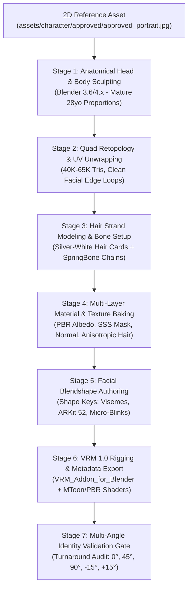
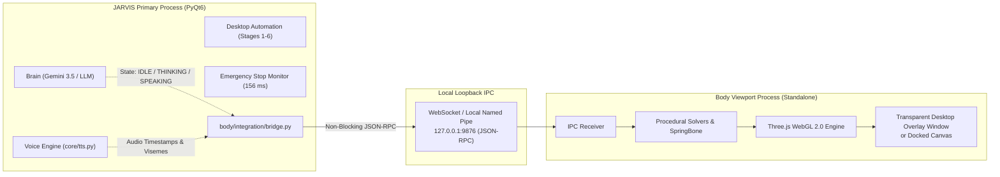
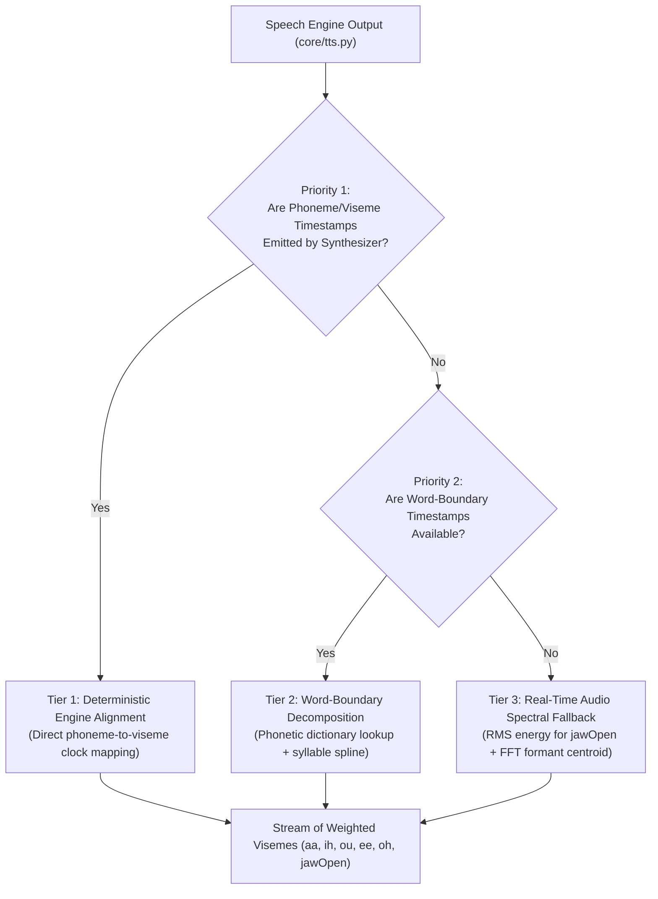
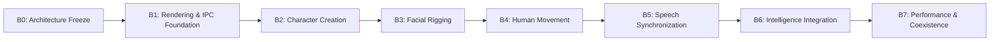

# JARVIS BODY SUBSYSTEM: REVISED ARCHITECTURE SPECIFICATION (B0)

**Document Type:** Subsystem Architectural Specification & Feasibility Blueprint  
**Subsystem:** JARVIS Visual Human Presence (`body/`)  
**Current Status:** B0 APPROVED — B1 AUTHORIZED  
**Authority:** Project Owner  
**Repository Scope:** `Mark-L-main/body/` and `Mark-L-main/assets/character/`  
**Governing Standard:** [PROJECT_CONSTITUTION.md](PROJECT_CONSTITUTION.md)  

---

## Executive Summary

This document presents the revised **B0 Architectural Specification** for JARVIS's visual human presence, incorporating all corrections from the architectural review.

### Core Architectural Mandates
1. **Existing JARVIS Capabilities Untouched:** The existing Brain (Gemini 3.5 Flash-Lite), memory systems, desktop automation actions, and safety gates remain completely unchanged.
2. **Visual Fidelity Over Arbitrary Numbers:** Her visual presence must faithfully embody the approved adult character identity; performance targets will be met through disciplined engineering, not by degrading character quality or facial identity.
3. **Lifelike Organic Dynamics:** She must not appear as a loop of canned animations; motion, breathing, gaze, and micro-expressions must be procedurally driven and organically alive even during idle states.
4. **Complete Fault Isolation:** The rendering subsystem runs in a decoupled process communicating via asynchronous local IPC. A graphics fault, WebGL crash, or shader compilation stall **can never interrupt Brain execution, voice processing, desktop automation, or emergency stop controls.**

---

## 1. Character Identity & Visual Reference Specification

The approved portrait in `assets/character/approved/approved_portrait.jpg` serves as the authoritative visual identity reference:

| Visual Attribute | Specification | Design & Identity Constraints |
| :--- | :--- | :--- |
| **Character Archetype** | Mature adult female digital human, approximately 28 years old. | Defined, refined adult cranial and facial proportions. Must avoid juvenile or stylized "chibi" tropes (no compressed lower face, no oversized eyes relative to cranium). |
| **Hair** | Long flowing silver-white hair. | Multi-layered strand cards with dynamic physics. Front parted fringe, sweeping shoulder locks, and long flowing back mane. |
| **Eyes** | Luminous blue-violet irises with detailed limbal rings. | Parallax iris depth, defined eyelashes, subtle moist specular reflections; capable of subtle gaze convergence. |
| **Complexion & Skin** | Soft, refined, mature fair complexion. | Requires custom PBR/SSS shading (subsurface scattering and soft rim lighting) rather than flat anime cel-shading. |
| **Costume** | Tailored black high-neck sleeveless outfit. | Clean, structured neckline and shoulders; dark matte fabric with micro-weave roughness normal maps. |
| **Visual Consistency** | Fixed identity across multi-angle views. | Must preserve identical facial bone structure across Front ($0^\circ$), 3/4 ($45^\circ$), Side ($90^\circ$), and tilt angles. |

---

## 2. Character Creation Pipeline (Blender to VRM 1.0)

Because the approved portrait is a 2D reference image, Three.js cannot directly render it without an authored 3D asset. The following multi-stage creation pipeline is established:

### Pipeline Steps in Detail:
1. **Stage 1 — Sculpting:** Sculpt high-resolution anatomical head, neck, and shoulders in Blender, matching the bone structure of the approved portrait (slender jawline, elegant chin, defined nose bridge).
2. **Stage 2 — Retopology:** Construct clean, quad-dominant geometry optimized for real-time facial articulation. Loops strictly surround the mouth orifice, orbital cavities, and nasolabial folds. Target budget: 40,000–65,000 triangles.
3. **Stage 3 — Hair Card Authoring:** Model silver-white hair using layered polygonal cards with alpha dithering. Rig with dedicated hair bone chains for secondary physics.
4. **Stage 4 — Texture & Shader Strategy:**
   * *The MToon Realism Challenge:* Standard MToon provides flat 2-tone cel-shading. To match our approved portrait's refined hybrid look, we employ custom PBR materials with a subsurface scattering mask, custom skin roughness maps, and anisotropic specular highlights on the hair.
5. **Stage 5 — Shape Keys & Morph Targets:** Author custom facial blendshapes directly on the mesh rather than relying on automated converters.
6. **Stage 6 — VRM 1.0 Export:** Rig to humanoid standard, attach SpringBone physics colliders to hair and shoulders, and export via `VRM_Addon_for_Blender`.
7. **Stage 7 — Multi-Angle Consistency Gate:** Render 5-angle turnarounds to prove facial identity stability before approving the model for animation.

---

## 3. Facial Rigging & Expression Architecture

### Non-Standardization of ARKit 52 in VRM
VRM 1.0 standardizes only 21 preset expression slots (`happy`, `angry`, `sad`, `relaxed`, `surprised`, `aa`, `ih`, `ou`, `ee`, `oh`, `blink`, `blinkLeft`, `blinkRight`, `lookUp`, `lookDown`, `lookLeft`, `lookRight`, `neutral`). It does **not** guarantee that every downloaded or exported model contains all 52 Apple ARKit blendshapes.

### Normalized Expression Interface
To decouple facial animation logic from model-specific rigging quirks, the body subsystem defines a 3-tier normalized expression interface:

| Tier | Blendshape Group | Description & Role | Fallback Policy if Unauthored |
| :--- | :--- | :--- | :--- |
| **Tier 1 (Mandatory)** | Standard Visemes & Blinks | `viseme_aa`, `viseme_ih`, `viseme_ou`, `viseme_ee`, `viseme_oh`, `blink`, `blinkLeft`, `blinkRight`, `lookUp`, `lookDown`, `lookLeft`, `lookRight`, `jawOpen`. | **Zero tolerance.** Model rejected if missing any Tier 1 shape key. |
| **Tier 2 (Primary Emotion)** | Core Expressive Morphs | `mouthSmile`, `mouthFrown`, `browInnerUp`, `browDownLeft`, `browDownRight`, `eyeSquintLeft`, `eyeSquintRight`. | Synthesized via combination of Tier 1 VRM presets (`happy`, `surprised`, `relaxed`). |
| **Tier 3 (Extended ARKit)** | Subtle Micro-Articulations | Cheek puffs, nose sneers, lip puckers, jaw slides. | Gracefully ignored if unauthored; does not crash or distort face. |

### Facial Identity Invariant
During blendshape articulation, soft tissues (lips, cheeks, eyelids, eyebrows) move freely, but vertex displacements on the cranial base, zygomatic arch, and jawline are clamped ($\le 1.0$) to prevent facial warping or breaking the character's 28-year-old adult bone structure.

---

## 4. Rendering Isolation & Process Architecture

### Thread Affinity & Why a Separate Process is Mandatory
PyQt6 GUI classes (including `QWebEngineView`) have strict main-thread affinity. Moving them into background worker threads causes undefined behavior and Qt event-loop deadlocks.

Furthermore, GPU rendering in WebGL can experience shader compilation pauses, driver context loss, or memory pressure. If run within the main JARVIS process, any graphics hang would stall the desktop automation loop or freeze the emergency stop hotkey.

### Decoupled Process Blueprint:

### Fault Isolation Guarantees:
1. **Uninterrupted Brain Execution:** If the body process crashes, exits, or restarts, `main.py` continues uninterrupted.
2. **Unimpeded Emergency Stop:** The 156 ms Emergency Stop mechanism runs on its dedicated Win32 hook in the main process, completely independent of the rendering process.
3. **Crash Recovery:** The main process monitors the body process PID; if terminated, it can gracefully restart the viewport without restarting JARVIS.

---

## 5. Speech Synchronization & Lip-Sync Hierarchy

To achieve natural lip motion without claiming impossible capabilities from audio analysis alone, speech synchronization follows a strict 3-tier priority hierarchy:

### Synchronization Tiers:
1. **Priority 1 (Engine Timestamps):** When using Microsoft EdgeTTS or Kokoro, speech synthesis boundary events deliver exact millisecond offsets for words and phonemes. The mouth shape is locked directly to this deterministic clock.
2. **Priority 2 (Word-Boundary Syllable Spline):** When word boundaries are known but exact phonemes are missing, the word's phonetic transcription is retrieved from CMUdict, allocating duration across syllables using cubic Hermite interpolation.
3. **Priority 3 (Real-Time Spectral Fallback):** Real-time RMS energy drives `jawOpen`, while first and second spectral formants ($F_1, F_2$) approximate basic vowel shapes (`aa`, `ih`, `ou`, `ee`, `oh`). Consonants ($m, p, b$) are inferred from energy dips.
4. **Non-Invasive Tap:** Audio buffers are read via non-blocking shared memory or IPC streaming from `sounddevice`; playback is never blocked, delayed, or re-sampled.

---

## 6. Rendering Performance, Telemetry & Resource Budget

### Measured Host Baseline vs. Budgets

| Metric | Measured Host Baseline | Proposed Subsystem Budget | Allocation & Safety Margin |
| :--- | :--- | :--- | :--- |
| **GPU Dedicated VRAM** | 176 MiB used / 3760 MiB free | $\le 500\text{ MB}$ dedicated | Leaves $\ge 3.2\text{ GB}$ VRAM free for OmniParser v2 and OS tasks. |
| **System RAM** | 11.92 GB used / 3.5 GB free | $\le 300\text{ MB}$ footprint | Prevents system swap thrashing on the 16 GB host. |
| **Frame Rate Target** | N/A (Idling) | 60 FPS (measured target) | If GPU load spikes during desktop automation, renderer gracefully drops to 30 FPS rather than distorting shaders. |
| **Frame Time Variance** | N/A | $\le 16.6\text{ ms}$ (at 60 FPS) | Smooth procedural animation without micro-stuttering. |

*Protocol:* Initial figures are treated strictly as **targets to be measured and validated**. A dedicated real-time telemetry probe (`body/rendering/telemetry.py`) will log actual VRAM, RAM, and FPS during milestone testing.

---

## 7. Revised Subsystem Milestone Sequence (B0 to B7)

Development will proceed through eight sequential milestones. Each milestone requires empirical verification before advancing:

### Milestone Specifications:

#### Milestone B0: Architecture Freeze (Current)
* **Scope:** Correct technical assumptions, define interfaces, establish resource budgets, and document character creation and rendering isolation blueprints.
* **Deliverables:** Approved `BODY_SUBSYSTEM_ARCHITECTURE_ASSESSMENT.md`, updated `CHANGELOG.md`, directory structure, approved assets.
* **Acceptance Criteria:** Architectural review approval from Project Owner.

#### Milestone B1: Rendering and IPC Foundation
* **Scope:** Standalone viewport process (Three.js WebGL 2.0); local loopback IPC (WebSocket/JSON-RPC); automated heartbeat and crash recovery harness; test cube/dummy humanoid model.
* **Deliverables:** `body/rendering/`, `body/integration/bridge.py`, IPC benchmark script.
* **Acceptance Criteria:** Sustained 60 FPS on test geometry; IPC round-trip latency $< 5\text{ ms}$; killing the viewport process leaves JARVIS running with zero interruption.

#### Milestone B2: Character Creation
* **Scope:** Sculpt, retopologize, texture, and rig the mature 28yo silver-haired, blue-violet-eyed character in Blender; export to VRM 1.0; author PBR/MToon hybrid shaders.
* **Deliverables:** `body/models/jarvis_v1.vrm`, multi-angle turnaround renders ($0^\circ, 45^\circ, 90^\circ, -15^\circ, +15^\circ$).
* **Acceptance Criteria:** Visual fidelity review confirming identity match against `approved_portrait.jpg`; polygon count $\le 65\text{K}$; zero texture tearing.

#### Milestone B3: Facial Rigging
* **Scope:** Author and calibrate facial blendshapes on the model (Tier 1 visemes, blinks, brows, jaw); implement normalized expression interface in Python controller.
* **Deliverables:** `body/facial_rig/`, expression calibration test script.
* **Acceptance Criteria:** 100% of Tier 1 blendshapes articulate cleanly; facial identity invariant verified (no cranial deformation).

#### Milestone B4: Human Movement
* **Scope:** Procedural breathing harmonic solver; natural eye saccades and randomized micro-blinks; damped head/eye look-at tracking; VRM SpringBone hair dynamics.
* **Deliverables:** `body/animation/breathing.py`, `body/animation/gaze_tracker.py`, hair physics configuration.
* **Acceptance Criteria:** Organic lifelike idle presence; hair flows naturally during head turn without clipping through chest.

#### Milestone B5: Speech Synchronization
* **Scope:** Priority 1 (engine timing) + Priority 2 (word boundaries) + Priority 3 (spectral fallback); non-invasive audio sample tap from `core/tts.py`.
* **Deliverables:** `body/lip_sync/`, audio tap hook, synchronization test harness.
* **Acceptance Criteria:** Audio-visual synchronization lag $< 25\text{ ms}$; realistic mouth movement during spoken sentences.

#### Milestone B6: Intelligence and Emotion Integration
* **Scope:** Connect `BodyStateBridge` to `main.py` state machine (`IDLE`, `LISTENING`, `THINKING`, `SPEAKING`, `EXECUTING`); map LLM emotional cues to subtle facial expressions.
* **Deliverables:** `body/controller.py`, full state integration.
* **Acceptance Criteria:** Avatar smoothly transitions expressions when JARVIS listens, thinks, speaks, or executes tasks.

#### Milestone B7: Performance and Coexistence
* **Scope:** Final coexistence stress test: Simultaneous avatar rendering (60 FPS) + OmniParser v2 desktop automation + TTS voice synthesis + emergency stop.
* **Deliverables:** Comprehensive evaluation document with measured telemetry logs.
* **Acceptance Criteria:** Total dedicated VRAM $\le 3.5\text{ GB}$; emergency stop halts actions within 250 ms; zero process crashes.

---

## 8. Governance & Strict Invariants

1. **Non-Destructive Evolution:** No existing files in `actions/`, `core/`, `brain/`, or `memory/` may be broken or refactored.
2. **Implementation Gate:** No dependencies are installed, and no code is executed in `body/` until Milestone B0 is formally authorized.
3. **Evidence Over Assumptions:** All performance claims are established through empirical telemetry, not theoretical estimates.

*Status: B0 APPROVED — B1 IN PROGRESS.*

---

## 9. Mandatory B0 Addendum (Approved Baseline Governance)

Before initiating B1 implementation, the following six architectural clarifications and constraints are formally established as frozen baselines:

1. **Separation of Target Budget vs. System GPU Safety Ceiling:**
   * **Avatar Target Budget:** $\le 500\text{ MiB}$ dedicated VRAM.
   * **System-wide GPU Safety Ceiling:** $\le 3.5\text{ GiB}$ across all concurrent processes (OmniParser v2 + Avatar Viewport + OS compositor). The 3.5 GiB figure is a system safety ceiling, **not** permission for the avatar subsystem to consume 3.5 GiB.
2. **Frame Rate Targets & Fallback:**
   * **60 FPS** is the measured rendering target on test and final geometry.
   * **Stable 30 FPS** is the acceptable fallback under heavy system contention (e.g. during intensive multi-window desktop automation).
3. **Emergency Stop Protection (156 ms Invariant):**
   * The existing verified Emergency Stop latency guarantee (156 ms) must be strictly preserved.
   * The body subsystem must **never** delay, intercept, or interfere with Emergency Stop execution.
4. **Secure Local IPC:**
   * **Loopback-Only Binding:** Restricted to `127.0.0.1`.
   * **Authentication:** Ephemeral session tokens (`secrets.token_urlsafe(24)`) required for handshake; unauthorized connection attempts are immediately dropped.
   * **Message Allowlisting:** Strict schema validation on inbound messages; unauthorized commands are rejected.
   * **One-Way Authority:** The body subsystem receives visual-state broadcasts; it never gains authority over desktop actions or system execution.
5. **Speech Synchronization Capabilities:**
   * Verified EdgeTTS boundary support: `boundary="WordBoundary"` yields exact millisecond offsets and durations.
   * Verified Kokoro token generation: token sample durations map to phoneme lengths.
   * Priority hierarchy remains strictly enforced: Engine timestamps > Word-boundary syllable spline > Spectral fallback.
6. **Telemetry & Empirical Reporting:**
   * All performance and resource metrics must be empirically measured and logged via dedicated probes (`psutil`, `nvidia-smi`), completely separated from theoretical estimates.

