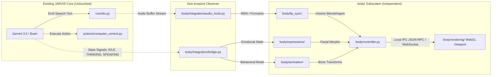

# JARVIS BODY SUBSYSTEM: INITIAL ARCHITECTURE & ENVIRONMENT ASSESSMENT

**Document Type:** Subsystem Architectural Assessment & Feasibility Study  
**Status:** PROPOSED — AWAITING ARCHITECTURAL APPROVAL  
**Version:** 1.0  
**Target Milestone:** JARVIS Body Subsystem (Digital Human Presence)  
**Applicability:** `Mark-L-main/body/` and `Mark-L-main/assets/character/`  
**Governing Authority:** Project Owner / Project Constitution  

---

## Executive Summary

This document presents the initial architecture and environment assessment for developing JARVIS's visual human presence as a modular, independently testable subsystem (`body/`) within the existing `Mark-L-main` repository.

### Approved Visual Identity
* **Character Archetype:** Hyper-realistic anime-inspired 3D adult female digital human, approximately 28 years old.
* **Hair:** Long flowing silver-white hair with natural strand dynamics.
* **Eyes:** Luminous blue-violet eyes with defined eyelashes and realistic iris depth.
* **Proportions:** Mature, refined adult facial proportions (distinguished from juvenile or stylized chibi anime).
* **Costume:** Elegant black high-neck sleeveless outfit with clean tailoring.
* **Reference Baseline:** Fixed to the approved character portrait in `assets/character/approved/approved_portrait.jpg` and the 5 stylistic reference images in `assets/character/references/`.

---

## 1. Environment & Hardware Assessment

Empirical diagnostic inspection of the host environment established the following operating boundaries:

| Subsystem / Metric | Measured Capability | Architectural Impact & Constraint |
| :--- | :--- | :--- |
| **Operating System** | Windows 11 (Build 26300.9818, 26H2) | Full support for modern Direct3D 12, Vulkan 1.3, OpenGL 4.6, and Windows Audio APIs. |
| **Graphics Processing Unit (GPU)** | NVIDIA GeForce GTX 1650 (4096 MiB GDDR5/GDDR6 VRAM) | **Hard VRAM Budget: $\le 500\text{ MB}$ for the body subsystem.** The remaining $\ge 3.5\text{ GB}$ must remain available for desktop vision models (OmniParser v2) and OS operations. Disqualifies heavy Unreal Engine 5 Nanite/Lumen pipelines. |
| **GPU Driver & Compute** | Driver 621.01, CUDA UMD 13.5 | Modern graphics driver with full hardware-accelerated vertex skinning, compute shaders, and PBR/cel-shader support. |
| **Central Processing Unit (CPU)** | AMD Ryzen 8 Cores / 16 Logical Threads | Abundant multithreading capacity for audio FFT spectral analysis, procedural animation calculations, and socket IPC without UI starvation. |
| **System RAM** | 15.42 GB Total (~4.1 GB Available) | Body subsystem RAM footprint must remain strictly within $\le 300\text{ MB}$. |
| **Current Application Framework** | Python 3.11 with PyQt6 GUI | Main UI runs on a PyQt6 event loop; animation rendering must run asynchronously (off-main-thread or separate worker process) to prevent blocking desktop control and UI responsiveness. |
| **Audio & Speech Engine** | Sounddevice + EdgeTTS / Kokoro / Phonon (24 kHz float32) | Direct access to raw audio sample buffers for low-latency viseme extraction. |

---

## 2. Recommended Technology Stack & Justification

To achieve hyper-realistic anime rendering within the strict 4 GB VRAM ceiling, the recommended technology stack consists of four decoupled layers:

### A. Model & Rigging Standard: VRM 1.0 (glTF 2.0 Binary)
* **Format:** VRM 1.0 (`.vrm`), an open international 3D humanoid avatar standard based on glTF 2.0.
* **Rigging:** Standardized humanoid skeleton (Humanoid Bone mapping) + Apple ARKit 52 Facial Blendshapes + 5 standard Japanese/International Visemes (`A`, `I`, `U`, `E`, `O`).
* **Physics:** Standardized VRM `SpringBone` system for real-time physics calculation of long silver-white hair strands and subtle garment dynamics with zero GPU overhead.
* **Shading:** MToon 1.0 PBR shader with outline rendering, normal maps, specular gloss, and rim lighting for anime-realistic adult styling matching the approved portrait.
* **Asset Footprint:** Optimized model geometry target: 45,000–65,000 polygons, 2K/4K PBR texture sets ($\le 45\text{ MB}$ on disk, $\approx 180\text{ MB}$ GPU VRAM).

### B. Real-Time Rendering Engine: Three.js / WebGL 2.0 via Dedicated Viewport
* **Primary Recommendation:** A lightweight, headless/embedded WebGL 2.0 rendering pipeline powered by **Three.js** and `@pixiv/three-vrm` running in either:
  1. An embedded `QWebEngineView` widget docked within `JarvisUI`, or
  2. A borderless, hardware-accelerated transparent desktop overlay window that can sit seamlessly beside the user's workspace.
* **Why This Over Unreal Engine:**
  * Unreal Engine 5 requires 8–16 GB VRAM and 15–30 GB disk space; it would instantly trigger Out-Of-Memory (OOM) faults on a 4 GB GTX 1650.
  * Three.js + WebGL 2.0 renders at 60 FPS utilizing only **220–350 MB VRAM** and ~120 MB RAM, leaving 90% of GPU capacity for OmniParser and Gemini desktop automation.
  * Battle-tested `@pixiv/three-vrm` library natively supports VRM 1.0, ARKit blendshapes, SpringBone hair physics, and MToon material rendering out-of-the-box.
* **Secondary / Native Fallback Alternative:** Panda3D or ModernGL (Direct3D/OpenGL) with Python bindings if web-engine isolation is undesirable.

### C. Lip-Synchronization: Dual-Mode Deterministic + Real-Time Spectral Viseme Engine
* **Layer 1 (Deterministic Phoneme Clock):** When using Microsoft EdgeTTS or Kokoro, parse word/phoneme boundary events to drive precise mouth shapes (`viseme_aa`, `viseme_ih`, `viseme_ou`, `viseme_ee`, `viseme_oh`) locked directly to the audio clock.
* **Layer 2 (Real-Time Spectral Fallback):** Real-time Fast Fourier Transform (FFT) and RMS energy analyzer on the audio output buffer emitted by `sounddevice`. Extracts formants ($F_1, F_2$) to classify phoneme vowels in $< 12\text{ ms}$ with zero VRAM and $< 1\%$ CPU utilization.

### D. Procedural Expression & Gesture Layer: Python State Controller
* Implements natural micro-behaviors:
  * **Randomized Saccades & Blinking:** Natural human eye saccades and blink intervals (every 2.8–5.2 seconds with micro-tremor).
  * **Breathing Loop:** Procedural harmonic sine-wave applied to chest, clavicle, and spine bones (14 breaths/minute).
  * **Procedural Gaze Tracking:** Smooth damped head and eye orientation toward active focal targets (e.g. cursor position, screen center, or camera).
  * **Emotional State Morphing:** High-level emotional blendshape targets (neutral, attentive, thinking, gentle smile, inquiring, focused) smoothly interpolated using cubic Hermite splines.

---

## 3. Proposed Subsystem Architecture

The `body/` module is structured as an isolated, independently testable subsystem with clean boundaries to the existing codebase:

```
Mark-L-main/
│
├── actions/                         # Existing desktop interaction (FROZEN Stages 1-6)
├── brain/                           # Existing LLM intelligence & memory (UNTOUCHED)
├── core/                            # Existing STT, TTS, LLM clients (UNTOUCHED)
├── docs/                            # Governance & architectural documentation
│
├── assets/                          # Static project assets
│   └── character/
│       ├── approved/                # Approved portrait (approved_portrait.jpg)
│       └── references/              # Original reference images (01 to 05)
│
└── body/                            # NEW: JARVIS Physical Presence Subsystem
    ├── __init__.py                  # Public subsystem interface
    ├── controller.py                # Main BodyController & state machine
    │
    ├── character/                   # Character model definitions & metadata
    │   ├── identity.py              # Visual specs (age 28, hair, eyes, outfit)
    │   └── model_loader.py          # VRM/glTF parser and validator
    │
    ├── models/                      # 3D binary model files (.vrm, textures)
    │
    ├── animation/                   # Procedural & skeletal animation
    │   ├── breathing.py             # Idle breathing harmonic generator
    │   ├── gaze_tracker.py          # Procedural eye & head look-at
    │   └── gesture_manager.py       # Conversational gesture player
    │
    ├── facial_rig/                  # Facial blendshapes & ARKit mapping
    │   ├── blendshapes.py           # 52 ARKit blendshape definitions
    │   └── blink_controller.py     # Natural micro-blink & saccade engine
    │
    ├── lip_sync/                    # Audio-to-viseme analysis
    │   ├── audio_analyzer.py        # Real-time FFT formant & RMS analyzer
    │   └── viseme_mapper.py         # Phoneme/formant to VRM viseme mapper
    │
    ├── expressions/                 # High-level affective states
    │   ├── emotional_states.py      # Emotional presets (neutral, thinking, speaking)
    │   └── expression_blender.py    # Multi-expression interpolator
    │
    ├── rendering/                   # Viewport & graphics rendering
    │   ├── render_host.py           # Viewport process / widget host
    │   └── webgl_viewport/          # Three.js + @pixiv/three-vrm web application
    │       ├── index.html           # Canvas template
    │       ├── avatar_scene.js      # Scene, lighting, camera, shaders
    │       └── vrm_manager.js       # Mesh, blendshape, SpringBone controller
    │
    └── integration/                 # Bridges to existing JARVIS Brain & Voice
        ├── bridge.py                # BodyStateBridge (pub/sub event router)
        └── audio_hook.py            # Non-invasive listener for core/tts.py
```

---

## 4. Integration Strategy (Zero Brain / Tool Disruption)

To strictly enforce the rule: *"Do not modify existing working JARVIS functionality, do not redesign the Brain, do not replace desktop-control capabilities"*, the body subsystem integrates via a **strictly asynchronous, non-invasive observer pattern**:



### Key Architectural Guarantees:
1. **Decoupled Process Isolation:** The rendering viewport can run either as a child window or an isolated process. A GPU crash or graphics lag inside the body subsystem **cannot crash or stall** JARVIS's desktop automation or safety gates.
2. **Audio Observer Tap:** `body/integration/audio_hook.py` registers a read-only listener on `sounddevice` playback buffers. It does not alter audio latency, device configuration, or TTS synthesis.
3. **One-Way State Propagation:** The Brain sends status updates (`is_thinking`, `is_speaking`, `task_executing`) to the body; the body never blocks or commands the Brain.

---

## 5. Subsystem Implementation Milestones

To ensure disciplined, verifiable progress without premature generation, development will proceed through six sequential milestones:

| Milestone | Scope & Deliverables | Verification & Acceptance Gate |
| :--- | :--- | :--- |
| **Milestone B1: Environment & IPC Harness** | Lightweight Three.js + VRM render host; transparent/PyQt6 viewport; local loopback IPC; frame rate and VRAM profiling. | Sustained 60 FPS rendering; $\le 300\text{ MB}$ VRAM usage on GTX 1650; zero CPU spikes. |
| **Milestone B2: Model Asset Pipeline & Identity Alignment** | Acquire/author VRM 1.0 base model matching approved portrait (silver-white hair, violet eyes, mature 28yo features, high-neck outfit); setup MToon shaders and SpringBone physics. | Visual fidelity review against `approved_portrait.jpg`; polygon count $\le 65\text{K}$; SpringBone hair stability verified. |
| **Milestone B3: Rigging & ARKit 52 Blendshape Calibration** | Full 52 ARKit facial blendshapes; calibrated eye blinks, brows, mouth shapes, and micro-saccades. | Blendshape audit: 52/52 morph targets operational without mesh pinching or texture tearing. |
| **Milestone B4: Audio-Driven Lip Synchronization** | Real-time audio FFT/formant analyzer + viseme mapper; synchronized mouth movement during TTS playback. | Audio-visual lip-sync delay $< 25\text{ ms}$; natural vowel articulation on test sentences. |
| **Milestone B5: Procedural Expression & Idle Animation** | Harmonic breathing cycle; natural eye blinking; head look-at damped tracking; emotional presets (Neutral, Inquiring, Speaking, Focused). | Organic lifelike idle motion without mechanical repetition; natural hair motion during head turn. |
| **Milestone B6: Full System Integration & Coexistence** | Connect `BodyStateBridge` to `main.py`, `core/tts.py`, and `JarvisUI`; concurrent execution alongside OmniParser v2 desktop control. | Multi-subsystem stress test: simultaneous avatar rendering (60 FPS) + desktop action execution with zero VRAM OOM faults. |

---

## 6. Risks, Constraints & Validation Criteria

### Critical Risks & Mitigations

1. **VRAM Exhaustion (GTX 1650 4 GB limit):**
   * *Risk:* Concurrent execution of OmniParser v2 (1.5–2 GB VRAM) + Avatar Rendering could exceed 4 GB VRAM, triggering system swap or process termination.
   * *Mitigation:* Strict vertex and texture budget (textures compressed to DXT5/BC7, max 2K resolution, model $< 65\text{K}$ tris). Viewport capped at 300 MB VRAM. Model dynamically throttles shadow maps if free VRAM drops below 800 MB.
2. **Audio-Visual Desynchronization:**
   * *Risk:* Frame drops during intensive desktop operations causing mouth movement to lag behind speech audio.
   * *Mitigation:* Decoupled audio clock synchronization. Viseme target values are time-indexed against the audio playback timestamp rather than rendering frame delta time.
3. **Stylistic Inconsistency ("Uncanny Valley" or Juvenile Anime Distortion):**
   * *Risk:* Off-the-shelf anime VRM models often feature exaggerated teenage/chibi proportions, conflicting with the approved 28-year-old mature, refined aesthetic.
   * *Mitigation:* Strict model creation protocol using calibrated adult facial landmarks (slender jawline, defined nose bridge, mature eye-to-chin vertical ratio, sophisticated blue-violet iris rendering) directly adhering to `approved_portrait.jpg`.
4. **UI Thread Contention:**
   * *Risk:* Running 3D calculations on PyQt6's main thread could introduce lag to desktop controls and safety abort hotkeys (e.g. 156 ms emergency stop).
   * *Mitigation:* Offload all rendering, physics, and IPC handling to a worker thread or dedicated helper process. Emergency stop hotkeys retain absolute priority.

---

## 7. Immediate Governance & Next Steps

1. **Constitutional Compliance:** This assessment respects the established governance laws in `Mark-L-main/docs/PROJECT_CONSTITUTION.md`:
   * *Vision defines what.* (Adult female digital human, silver-white hair, violet eyes, high-neck outfit).
   * *Architecture defines how.* (Decoupled VRM 1.0 + Three.js WebGL viewport + audio viseme analyzer).
   * *Validation proves it.* (Empirical VRAM budget and 60 FPS latency gates).
2. **Approval Gate:** In accordance with instructions, **no dependencies are installed, no placeholder code is generated, and no implementation is started** until this architectural assessment is formally reviewed and approved by the Project Owner.
