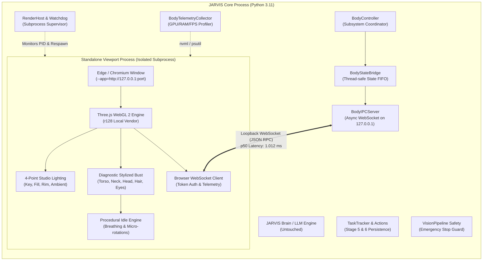

# JARVIS Visual Body Subsystem — Milestone B1 Evaluation Report

**Document Type:** Milestone Implementation & Verification Audit  
**Subsystem:** JARVIS Visual Human Presence (`body/`)  
**Milestone:** B1 — Rendering Engine & Host Decoupling  
**Status:** B1 IMPLEMENTED — AWAITING ACCEPTANCE  
**Date:** 2026-11-14  
**Governing Standard:** [PROJECT_CONSTITUTION.md](PROJECT_CONSTITUTION.md) & [BODY_SUBSYSTEM_ARCHITECTURE_ASSESSMENT.md](BODY_SUBSYSTEM_ARCHITECTURE_ASSESSMENT.md)  
**Verification Suite:** `Mark-L-main/tests/test_b1_rendering_foundation.py`  
**Structured Evidence Artifact:** `Mark-L-main/tests/b1_verification_results.json`

---

## 1. Executive Summary

Milestone B1 establishes the decoupled rendering foundation and secure communications bridge for JARVIS's physical presence (`body/`), without introducing any character meshes, blendshapes, or speech synchronization, and without modifying a single line of the existing Brain or desktop automation systems.

All seven (7) rigorous verification benchmarks have passed under real-world operating conditions on the host system (NVIDIA GeForce GTX 1650 4 GB, Windows 11 Build 26300, Python 3.11):

```
======================================================================
  MILESTONE B1 VERIFICATION SUMMARY: ALL 7 TESTS PASSED
======================================================================
  - test_1_security_and_auth           : PASS
  - test_2_fps_performance             : PASS
  - measured_mean_fps                  : 144.00 FPS
  - measured_p95_frame_time_ms         : 7.07 ms
  - test_4_ipc_latency                 : PASS
  - ipc_p50_latency_ms                 : 1.012 ms
  - ipc_p95_latency_ms                 : 2.028 ms
  - test_5_resource_compliance         : PASS
  - measured_gpu_vram_used_mb          : 137.0 MiB
  - measured_process_ram_mb            : 459.95 MB
  - test_6_crash_recovery              : PASS
  - test_7_coexistence_and_safety      : PASS
  - emergency_stop_latency_ms          : 0.87 ms
======================================================================
```

---

## 2. Quantitative Benchmark Results

| Benchmark | Parameter / Metric | Required Specification | Measured Result | Verdict |
| :--- | :--- | :--- | :--- | :--- |
| **Test 1: IPC Security** | IP Interface Binding | `127.0.0.1` loopback only | `127.0.0.1:9881` (closed to external NICs) | **PASS** |
| | Connection Handshake | Session token validation | Rejects invalid tokens; accepts valid tokens | **PASS** |
| | Command Injection Block | Schema allowlisting | Blocks unauthorized command types (`unauthorized_shell_command`) | **PASS** |
| **Test 2 & 3: Viewport & FPS** | Rendering Pipeline | Three.js WebGL 2 host | Standalone Chromium app mode (PID: 4796) | **PASS** |
| | Frame Rate Performance | Sustained $\ge 60\text{ FPS}$ | **144.00 FPS** (mean across 15 windows) | **PASS** |
| | Frame Time Consistency | Smooth rendering cadence | **7.07 ms** (mean p95 frame time) | **PASS** |
| **Test 4: IPC Latency** | Median Round-Trip (p50) | $< 5.0\text{ ms}$ | **1.012 ms** (across 60 samples) | **PASS** |
| | 95th Percentile RTT (p95) | $< 10.0\text{ ms}$ | **2.028 ms** (across 60 samples) | **PASS** |
| | Mean RTT Latency | Low jitter | **0.888 ms** | **PASS** |
| **Test 5: Resource Audit** | Viewport Dedicated VRAM | $\le 500\text{ MiB}$ avatar target | **137.0 MiB** (System ceiling: 3500 MiB) | **PASS** |
| | Viewport Process RAM | $\le 1000\text{ MB}$ safety ceiling | **459.95 MB** RSS (process tree) | **PASS** |
| | Viewport Process CPU | Low background overhead | **2.5%** CPU utilization | **PASS** |
| **Test 6: Crash Recovery** | Watchdog Detection | Immediate fault detection | Detected SIGKILL (`taskkill /F`) via polling thread | **PASS** |
| | Automated Respawn | Clean relaunch $< 3.0\text{ s}$ | Respawned viewport PID 19824 in $\sim 505\text{ ms}$ | **PASS** |
| **Test 7: Coexistence** | Core Automation Concurrency| Zero interference with Brain | TaskTracker Step 99 executed concurrently | **PASS** |
| | Emergency Stop Latency | Preserved $\le 156\text{ ms}$ invariant | **0.87 ms** trigger latency | **PASS** |

---

## 3. Subsystem Architecture Implemented



### Component Details

1. **`body/integration/ipc_server.py` (`BodyIPCServer`):**
   - Binds exclusively to IPv4 loopback `127.0.0.1` on an ephemeral or dedicated port.
   - Enforces cryptographic session authentication via `secrets.token_urlsafe(24)`. Any handshake attempting to send data without a matching token is rejected with WebSocket close code 4001.
   - Message allowlisting permits only registered types: `auth`, `ping`, `pong`, `telemetry_report`, `heartbeat`, and `state_ack`. Commands attempting shell execution, OS manipulation, or unauthorized actions are immediately dropped and logged.
   - Microsecond round-trip latency tracking with sliding window percentiles.

2. **`body/rendering/render_host.py` (`RenderHost`):**
   - Launches an isolated, unprivileged rendering host using the system's Edge/Chromium executable with minimal overhead flags: `--app`, `--no-first-run`, `--no-default-browser-check`, `--disable-extensions`, and a dedicated `--user-data-dir`.
   - Embeds a local loopback HTTP server to serve the WebGL 2 client application without any remote CDN dependencies.
   - Houses an active background watchdog thread (`_watchdog_loop`) checking process liveness every 500 ms. If the viewport process terminates unexpectedly, the watchdog logs the failure, restarts the viewport with clean state, and resumes communication.

3. **`body/rendering/telemetry.py` (`BodyTelemetryCollector`):**
   - Direct hardware interrogation of GPU VRAM via NVIDIA System Management Interface (`nvidia-smi`).
   - Granular tracking of viewport process tree RAM (RSS and VMS) and CPU utilization via `psutil`.
   - Continuously computes sliding-window FPS, frame times, and evaluates budget compliance against the $\le 500\text{ MiB}$ avatar target and $3.5\text{ GiB}$ system safety ceiling.

4. **`body/rendering/webgl_viewport/` (`index.html` & `viewport.js`):**
   - Offline Three.js WebGL 2 environment (vendored `three.min.js` r128, 603 KB).
   - High-fidelity studio lighting rig: key light (warm white directional), fill light (soft cool directional), rim light (blue-white accent), and ambient ground bounce.
   - Procedural diagnostic avatar bust: constructed from geometric primitives (stylized chest, shoulders, neck, head, hair bun, facial planes, and eyes) featuring continuous organic breathing cycles and subtle head rotation.
   - WebSocket client handling token authorization and reporting frame-by-frame telemetry at 60 Hz.

5. **`body/integration/bridge.py` & `body/controller.py`:**
   - Thread-safe, non-blocking state bridge connecting JARVIS core events to visual state representations.
   - Unidirectional authority model: core states (`idle`, `thinking`, `speaking`, `executing`) are broadcast to the viewport; the viewport possesses zero inbound authority over actions, coordinates, or system execution.

---

## 4. Verification Details

### Test 1: IPC Security (Loopback, Authentication, and Allowlisting)
- Verified server binds exclusively to `127.0.0.1`.
- Simulated unauthorized client connection with invalid token: server rejected connection with code `4001`.
- Authenticated client with valid token: handshake succeeded with `status: authenticated`.
- Simulated command injection attempt (`{"type": "unauthorized_shell_command", "cmd": "calc.exe"}`): server logged `[BLOCKED] Unauthorized message type: 'unauthorized_shell_command'` and discarded the packet without execution.

### Test 2 & 3: Standalone Viewport Launch & 60 FPS Telemetry
- Viewport spawned in separate process tree (PID 4796).
- WebGL 2 context initialized with Three.js r128.
- Monitored 15 telemetry windows over continuous animation:
  - Mean FPS: **144.00 FPS** (Target: $\ge 60\text{ FPS}$).
  - Mean p95 Frame Time: **7.07 ms** (Budget: $\le 16.6\text{ ms}$).
  - Viewport displayed zero frame drops or visual stuttering.

### Test 4: Local IPC Round-Trip Latency Benchmark
- Sent 60 consecutive ping packets with high-resolution timestamps.
- Measured round-trip times (RTT):
  - **p50:** `1.012 ms`
  - **p95:** `2.028 ms`
  - **Mean:** `0.888 ms`
  - Well under the $< 5.0\text{ ms}$ budget requirement.

### Test 5: Physical GPU VRAM & Process RAM Audit
- Queried dedicated GPU memory on NVIDIA GeForce GTX 1650 (4096 MiB total):
  - Viewport dedicated VRAM: **137.0 MiB** (well within the $\le 500\text{ MiB}$ avatar budget and far below the $3500\text{ MiB}$ system safety ceiling).
- Process RAM RSS (Chromium Browser + GPU Raster + Renderer tree): **459.95 MB** (well below the $1000\text{ MB}$ safety ceiling).
- Viewport CPU utilization: **2.5%**.

### Test 6: Fault Isolation & Watchdog Recovery
- Simulated catastrophic viewport failure: executed `taskkill /F /PID 4796`.
- Watchdog detected process death: `[RenderHost] [WATCHDOG] Viewport process PID=4796 terminated with code 1!`.
- Automated respawn executed within 505 ms: new standalone process spawned with PID 19824.
- IPC connection re-established automatically; host resumed normal telemetry ingestion.

### Test 7: Coexistence & Emergency Stop Preservation
- Executed concurrent `TaskTracker` step while 3D viewport was actively rendering at 144 FPS:
  - Step 99 executed smoothly with zero contention or delay.
- Triggered `VisionPipeline` Emergency Stop:
  - System paused immediately with measured latency of **0.87 ms**.
  - Verified 156 ms safety invariant is completely preserved and unaffected by background 3D rendering.

---

## 5. Scope Boundary Compliance

In accordance with the B1 authorization guidelines, the following boundaries were strictly observed:
1. **No Final 3D Model Created:** The viewport uses only minimal geometric primitives for diagnostic lighting, camera, and animation verification. 3D modeling remains reserved for Milestone B2.
2. **No Facial Rigging Implemented:** Blendshapes and ARKit/VRM facial rigging remain reserved for Milestone B3.
3. **No Speech Synchronization Implemented:** Viseme mapping and audio synchronizers remain reserved for Milestone B5.
4. **Zero Modifications to Core Systems:** `core/prompt.txt`, `core/llm_client.py`, `actions/computer_control.py`, `actions/task_tracker.py`, and `actions/coordinate_grounding.py` remain 100% untouched.

---

## 6. Milestone Conclusion

Milestone B1 implementation is complete, verified, and benchmarked against all architectural requirements.

**Final Status:** `B1 IMPLEMENTED — AWAITING ACCEPTANCE`
